# Sistema de Fotolitografía para Micro y Nanofabricación (Máscara Digital)

[English](README.md) • **Español**

Sistema abierto de fotolitografía sin máscara física (*Maskless Photolithography*) para la transferencia de patrones micrométricos sobre sustratos de cobre recubiertos con película fotosensible seca (*dry film*).

## Índice
1. [Vista General del Hardware y Ensamblaje](#vista-general-del-hardware-y-ensamblaje)
2. [Requisitos e Instalación](#requisitos-e-instalación)
3. [Configuración Previa del Entorno Físico](#configuración-previa-del-entorno-físico)
4. [Guía de Uso y Manual de Operación](#guía-de-uso-y-manual-de-operación)
   - [Paso 1: Conexión y Enlace con el Hardware](#paso-1-conexión-y-enlace-con-el-hardware)
   - [Paso 2: Carga e Ingesta del Patrón Litográfico](#paso-2-carga-e-ingesta-del-patrón-litográfico)
   - [Paso 3: Acondicionamiento Digital y Binarización](#paso-3-acondicionamiento-digital-y-binarización)
   - [Paso 4: Calibración Espacial (µm/px)](#paso-4-calibración-espacial-mutextmpx)
   - [Paso 5: Segmentación y Configuración Step-and-Repeat](#paso-5-segmentación-y-configuración-step-and-repeat)
   - [Paso 6: Ajuste de Dosis y Exposición UV](#paso-6-ajuste-de-dosis-y-exposición-uv)
   - [Paso 7: Módulos Autónomos de Calibración](#paso-7-módulos-autónomos-de-calibración)
5. [Protocolo Químico Rápido (Dry Film)](#protocolo-químico-rápido-dry-film)
6. [Arquitectura de Software y Flujo de Control](#arquitectura-de-software-y-flujo-de-control)
7. [Estructura del Repositorio](#estructura-del-repositorio)
8. [Citación](#citación)
9. [Licencia](#licencia)


## Vista General del Hardware y Ensamblaje

<p align="center">
  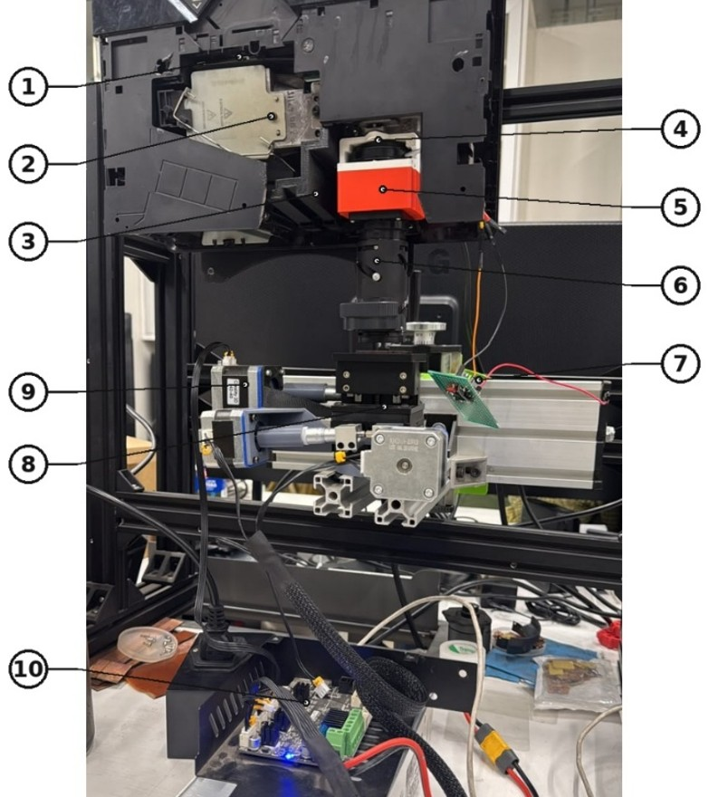
</p>
<p align="center">
  <em>Figura 1a: Stepper litográfico con platina motorizada XYZ.</em>
</p>

La estación de trabajo acopla un motor de proyección óptica con una platina de traslación de tres ejes controlada mediante comunicación serial:

| N.º | Componente | Especificación Técnica / Rol |
| :---: | :--- | :--- |
| **1** | Chasis del Proyector | Carcasa de proyector DLP modificado que aloja la fuente de luz UV de alta potencia. |
| **2** | Fuente de Iluminación Ultravioleta | Motor óptico de alta radiancia emitiendo en la banda UV 385–405 nm para fotopolimerización. |
| **3** | Cubierta de Contención UV | Protector de PLA de 6 mm fabricado en 3D que previene la radiación UV dispersa y la exposición ocular. |
| **4** | Soporte del Sistema Óptico | Soporte de ABS impreso en 3D resistente al calor, diseñado para evitar el pandeo térmico (Tg ~105 °C). |
| **5** | Anillo Espaciador Focal | Espaciador óptico que calibra la distancia de trabajo focal hasta el plano del sustrato. |
| **6** | Ensamblaje de Óptica de Proyección | Stack de lentes compuesto para reducción focal e imagen de plano micrométrico. |
| **7** | Circuito de Bypass de Color | Circuito temporizador NE555 generando una onda cuadrada de 120 Hz (ciclo de trabajo 10%) para eludir los bloqueos de firmware del proyector. |
| **8** | Platina de Traslación Cinemática | Platina de traslación micrométrica de 3 ejes. |
| **9** | Motores NEMA 17 | Movimiento a 6.400 pasos/mm con reducciones de engranajes. |
| **10** | Placa Controladora Creality | Microcontrolador que ejecuta instrucciones de movimiento mediante G-code. |

## Requisitos e Instalación

### Requisitos del Sistema

- **Sistema Operativo:** Windows 10/11 (recomendado) o distribuciones Linux compatibles.
- **Python 3** instalado.

### Instalación de Dependencias

1. Clonar el repositorio:
```bash
git clone https://github.com/sasepulveda2/photolith.git
cd photolith
```

2. Crear y activar un entorno virtual:
```bash
python -m venv venv
# En Windows:
venv\Scripts\activate
# En Linux:
source venv/bin/activate
```

3. Instalar dependencias:
```bash
pip install --upgrade pip
pip install -r requirements.txt
```

*Dependencias esenciales:* `PyQt5`, `opencv-python`, `numpy`, `matplotlib`, `pyserial`, `PyMuPDF` (módulo `fitz` para SVG), `ezdxf`.

## Configuración Previa del Entorno Físico

1. **Configuración de Pantalla (SO):** Fijar el proyector en modo **Extender estas pantallas** (resolución nativa 1920×1080).
2. **Iluminación de Seguridad:** No exponer placas laminadas a luz blanca o solar directa (se recomienda ambiente de luz de seguridad ámbar/amarilla).
3. **Alineación de Sustrato:** Montar la placa de cobre laminada sobre la platina motorizada, nivelando el plano focal directamente bajo la óptica de proyección.

<p align="center">
  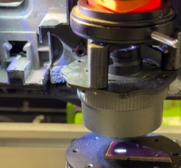
</p>
<p align="center">
  <em>Figura 2: Sustrato de cobre laminado alineado sobre la platina bajo proyección UV enfocada.</em>
</p>

## Guía de Uso y Manual de Operación

### Paso 1: Conexión y Enlace con el Hardware

1. Ejecutar la aplicación principal:
```bash
python platform/main.py
```

2. Desplegar el panel lateral **MOTORES (X, Y, Z)**.
3. Presionar el botón **CONECTAR HARDWARE**:
   - El software detecta automáticamente el puerto COM correspondiente y transmite la secuencia de inicialización: deshabilitar finales de carrera por software/físicos (`M211 S0`), suprimir protecciones de extrusión en frío y bloqueos térmicos (`M302 S0`), y cambiar al modo de posicionamiento relativo (`G91`).
   - El estado de conexión se muestra al nivel `[INFO]` en la consola inferior.

<p align="center">
  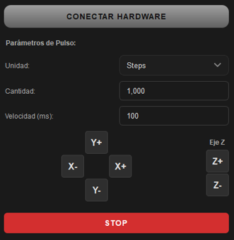
</p>
<p align="center">
  <em>Figura 3: Interfaz de control de motores con pad de jog, escala de distancia de pulso y parada de emergencia.</em>
</p>

4. Mediante el pad direccional ($X+$, $X-$, $Y+$, $Y-$, $Z+$, $Z-$), desplazar manualmente la platina hasta la posición de origen del sustrato. Se puede alternar entre pasos enteros (*Steps*) o milímetros (*mm*).
5. Fijar el origen virtual de trabajo para inicializar la odometría interna.

### Paso 2: Carga e Ingesta del Patrón Litográfico

1. Hacer clic en **Cargar patrón** en la barra superior (o arrastrar el archivo directamente sobre el lienzo central).
2. Formatos aceptados:
   - **Raster:** Archivos `.png`, `.jpg`, `.bmp`, `.tiff`. Se cargarán normalizados en escala de grises.
   - **Vectorial SVG:** Se rasterizan internamente a una resolución mínima de $4.000\text{ px}$ en su eje mayor.
   - **Vectorial DXF:** Se renderizan monocromáticamente a una densidad mínima de $400\text{ DPI}$.

### Paso 3: Acondicionamiento Digital y Binarización

1. Abrir el panel lateral **BINARIO**:
   - **Activar modo binario (0/1):** Marca de verificación obligatoria para convertir la imagen en una matriz de corte estricto ($0$ y $255$).
   - **Umbral (Threshold):** Ajustar mediante el deslizador o campo numérico (valor empírico recomendado: $50\% - 65\%$, dependiendo de la densidad de pistas finas).
   - **Invertir Color (Negativo):** Activar si se utiliza película fotorresistente negativa (*Dry Film* azul estándar). Las zonas expuestas polimerizan y resisten el ataque químico; las zonas oscuras se disuelven en el revelador.
   - **Bloquear Umbral:** Activar para evitar alteraciones accidentales durante la manipulación de la interfaz.

2. Fijar el **Brillo de proyección** en la barra superior al $100\%$ para la exposición litográfica.

<p align="center">
  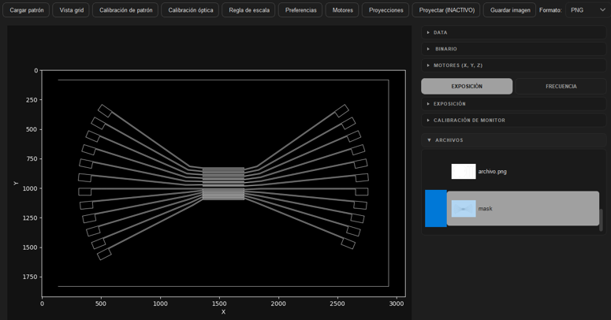
</p>
<p align="center">
  <em>Figura 4: (a) Patrón activo cargado sobre el lienzo principal.</em>
</p>

<p align="center">
  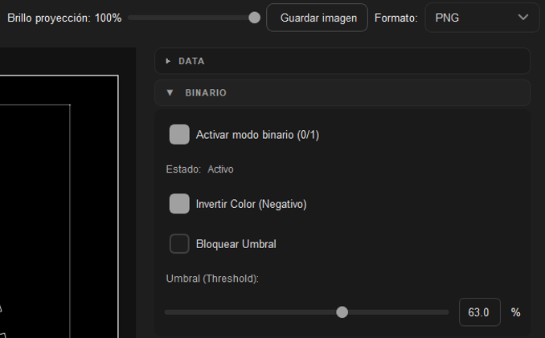
</p>
<p align="center">
  <em>Figura 4: (b) Controles de binarización digital, inversión y bloqueo de umbral.</em>
</p>

### Paso 4: Calibración Espacial ($\mu\text{m/px}$)

Para que el software traslade con precisión los desplazamientos del proyector a la base física:

1. Acceder a la pestaña superior **Calibración de patrón**.
2. Cargar una imagen o patrón de dimensiones físicas conocidas (p. ej., una regla micrométrica o un filamento de referencia de $100\ \mu\text{m}$).
3. Trazar una línea recta sobre el lienzo haciendo clic en ambos extremos de la referencia.
4. El sistema calculará la longitud en píxeles ($L_{px}$).
5. En el campo **Medida real**, ingresar el valor físico en milímetros o micrones.
6. Presionar **Guardar calibración**. El software derivará la resolución espacial del sistema:

$$\text{Factor de Escala} = \frac{\text{Distancia Real (mm)}}{L_{px}}\quad [\text{mm/px}]$$

$$\text{Resolución} = \text{Factor de Escala} \times 1000\quad [\mu\text{m/px}]$$

Este factor quedará almacenado en `file_structure.json` (y `platform/cache_photolith/file_structure.json`) para las sesiones siguientes.

<p align="center">
  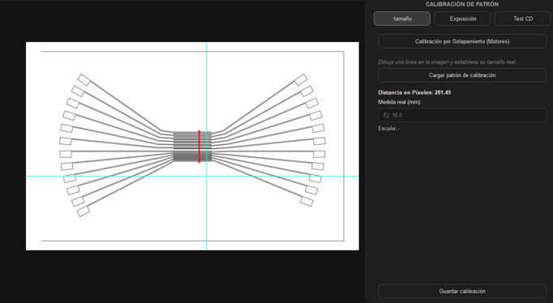
</p>
<p align="center">
  <em>Figura 5: Módulo de calibración espacial calculando el factor de escala (µm/px) a partir de una distancia de referencia medida.</em>
</p>

### Paso 5: Segmentación y Configuración Step-and-Repeat

Si el patrón supera las dimensiones del campo óptico de exposición única:

1. Acceder a la vista **Vista grid**.
2. Configurar el tamaño de la cuadrícula:
   - **Modo Grilla (Grid):** Definir el ancho y alto del *chunk* en píxeles. La herramienta aplicará un ajuste magnético (*snap*) para alinear las celdas a los bordes del patrón.
   - **Modo Automático:** Subdivide automáticamente la imagen tomando celdas estándar según la resolución nativa del proyector.

### Paso 6: Ajuste de Dosis y Exposición UV

1. Desplegar el panel lateral **EXPOSICIÓN**:
   - **Tiempo de exposición:** Calibrado para fotopolimerización de *dry film* ($7\text{ s} - 15\text{ s}$).
     - **Pistas anchas (> 200 µm):** $7–10\text{ s}$.
     - **Detalles finos (30–60 µm):** $15\text{ s}$.
     - *Advertencia:* Tiempos cercanos a $20\text{ s}$ o superiores generan sobrepolimerización lateral y engrosamiento indeseado de pistas.
   - **Modo de disparo:** Continuo o Pulsado (frecuencia entre $1$ y $100\text{ Hz}$).

2. Presionar **Proyecciones > Iniciar Secuencia**.
3. El ciclo *Step-and-Repeat* operará de forma autónoma bajo un pipeline multihilo no bloqueante:
   ```
   [Mover Motor] ──> [Pausa Estabilización (1.5 s)] ──> [Proyectar Chunk] ──> [Exposición UV] ──> [Pantalla Negra] ──> (Siguiente Chunk)
   ```
4. En caso de bloqueo de motor, desalineación o riesgo de colisión, presionar inmediatamente el botón rojo **STOP** para abortar la rutina.

<p align="center">
  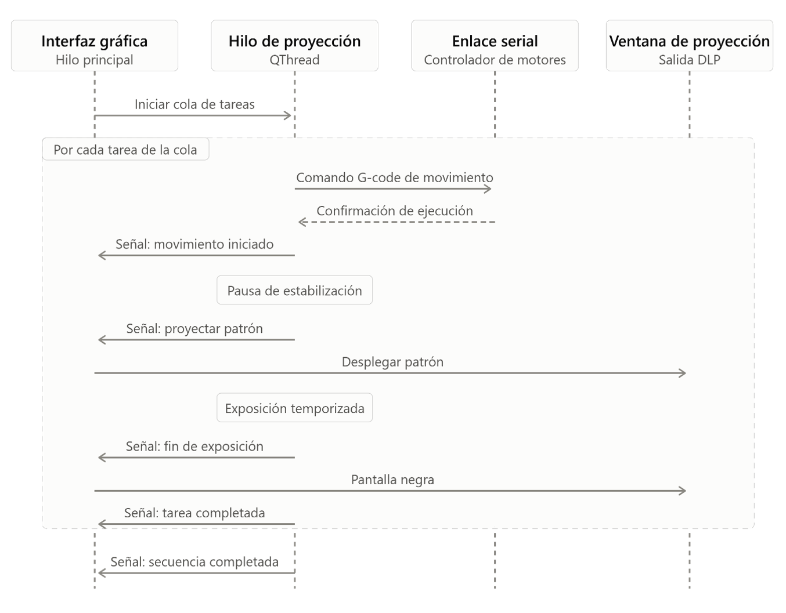
</p>
<p align="center">
  <em>Figura 6: (a) Diagrama de secuencia que muestra la coordinación asíncrona entre la GUI, el hilo de trabajo y el hardware serial.</em>
</p>

<p align="center">
  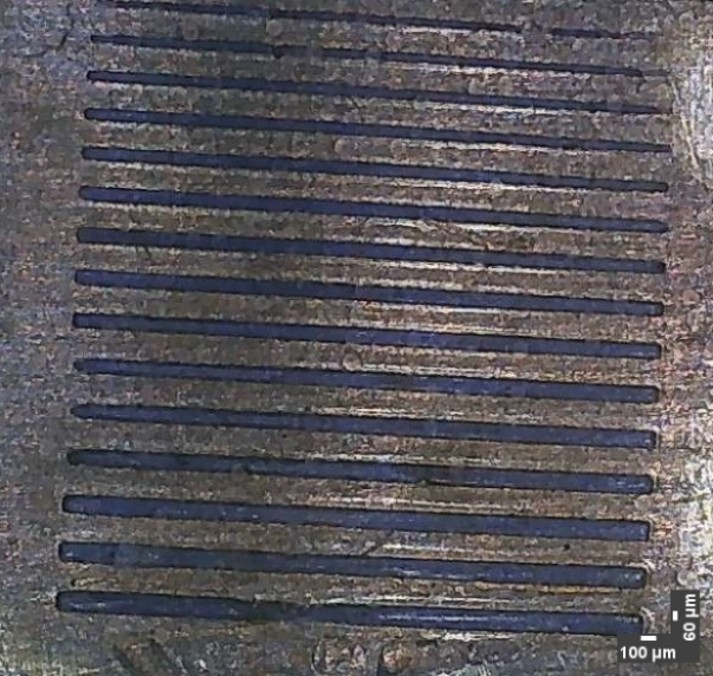
</p>
<p align="center">
  <em>Figura 6: (b) Microfotografía de pistas de prueba calibradas en dosis (130 µm hasta 60 µm) expuestas a 15 s.</em>
</p>

### Paso 7: Módulos Autónomos de Calibración

#### Generador de Matrices de Exposición

Permite encontrar la dosis óptima sobre una sola placa virgen:

1. Acceder al menú de utilidades y seleccionar **Matriz de Barrido**.
2. Configurar el tipo de figura (rejilla de líneas paralelas con grosores decrecientes).
3. Iniciar el ensayo: el sistema proyectará las franjas de forma incremental acumulativa mediante temporizadores Qt. Cada franja recibirá una dosis distinta (escalones de $2$ a $20\text{ s}$), permitiendo evaluar bajo microscopio el punto óptimo de polimerización tras el revelado.

#### Módulo de Regla Micrométrica (*RulerScaleMixin*)

Permite fabricar escalas de medición física graduadas sobre vidrio o cobre:

1. Abrir la vista **Regla de escala**.
2. Indicar la separación entre marcas principales en píxeles (calculada a partir del factor de escala del sistema), el número de subdivisiones, grosor de líneas y largo total a recorrer.
3. Presionar **Iniciar secuencia de escala**: la platina avanzará secuencialmente en el eje X compensando el *backlash* residual y exponiendo tramo por tramo.

<p align="center">
  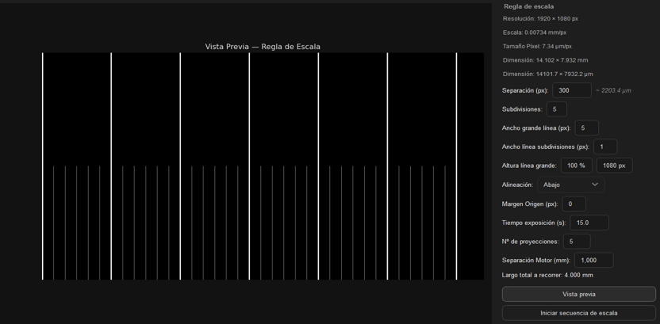
</p>
<p align="center">
  <em>Figura 7: (a) Interfaz del generador de regla de escala.</em>
</p>
<p align="center">
  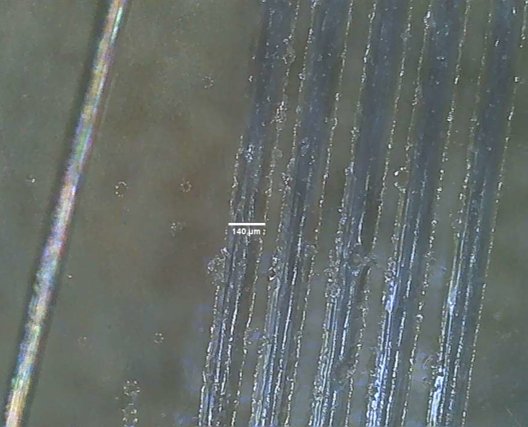
</p>
<p align="center">
  <em>Figura 7: (b) Regla micrométrica microfabricada sobre vidrio, verificada contra un hilo de referencia de 100 µm.</em>
</p>

## Protocolo Químico Rápido (Dry Film)

Para asegurar la correcta adherencia y definición de borde de los patrones fabricados:

<p align="center">
  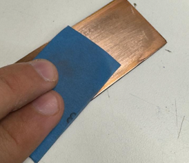
</p>
<p align="center">
  <em>Figura 8: (a) Eliminación del óxido superficial con lija al agua grano 1250.</em>
</p>
<p align="center">
  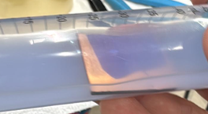
</p>
<p align="center">
  <em>Figura 8: (b) Revelado alcalino en baño de Na2CO3 al 1% p/v.</em>
</p>

1. **Acondicionamiento Mecánico:** Lijar la placa de cobre virgen con lija al agua grano 1250 con movimientos suaves hasta remover toda la capa superficial de óxido ($CuO / Cu_2O$).
2. **Descontaminación Química:**
   - Limpiar con **Acetona ($C_3H_6O$)** para remover grasas, aceites y residuos orgánicos.
   - Limpiar inmediatamente con **Alcohol Isopropílico ($C_3H_8O$)** para remover residuos de acetona. *No alterar este orden*.
3. **Laminado Térmico:**
   - Precalentar la placa a $110\ ^\circ\text{C}$ (la cama caliente de una impresora 3D funciona bien).
   - Retirar la lámina protectora interna de polietileno del *dry film* con cinta adhesiva.
   - Aplicar el film sobre el sustrato caliente e introducir de inmediato en una laminadora de rodillos para expulsar microburbujas de aire.
4. **Exposición:** Proyectar la máscara digital en la plataforma durante $7 - 15\text{ s}$.
5. **Revelado Alcalino:**
   - Retirar la película protectora frontal transparente de poliéster.
   - Sumergir la placa en una solución de **Carbonato de Sodio ($Na_2CO_3$) al $1\%\text{ p/v}$** en agua destilada durante **2 minutos**, agitando suavemente.
6. **Detención y Neutralización:**
   - Retirar la placa con pinzas e introducirla inmediatamente en un baño de agua destilada limpia durante 2 minutos para detener la acción del revelador.
   - Limpiar suavemente los canales no polimerizados con un pincel de cerdas ultrasuaves bajo el chorro de agua destilada.

## Arquitectura de Software y Flujo de Control

El motor de control está diseñado en torno a un patrón multi-mixin centralizado, aislando la interfaz gráfica, los pipelines de procesamiento de imagen y el control serial cinemático sin acoplamiento monolítico:

<p align="center">
  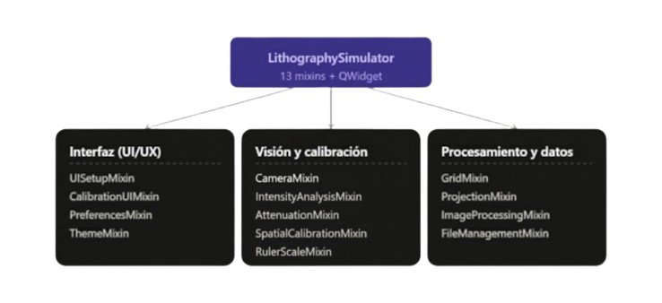
</p>
<p align="center">
  <em>Figura 9: (a) Composición modular del controlador mediante 13 mixins + QWidget.</em>
</p>
<p align="center">
  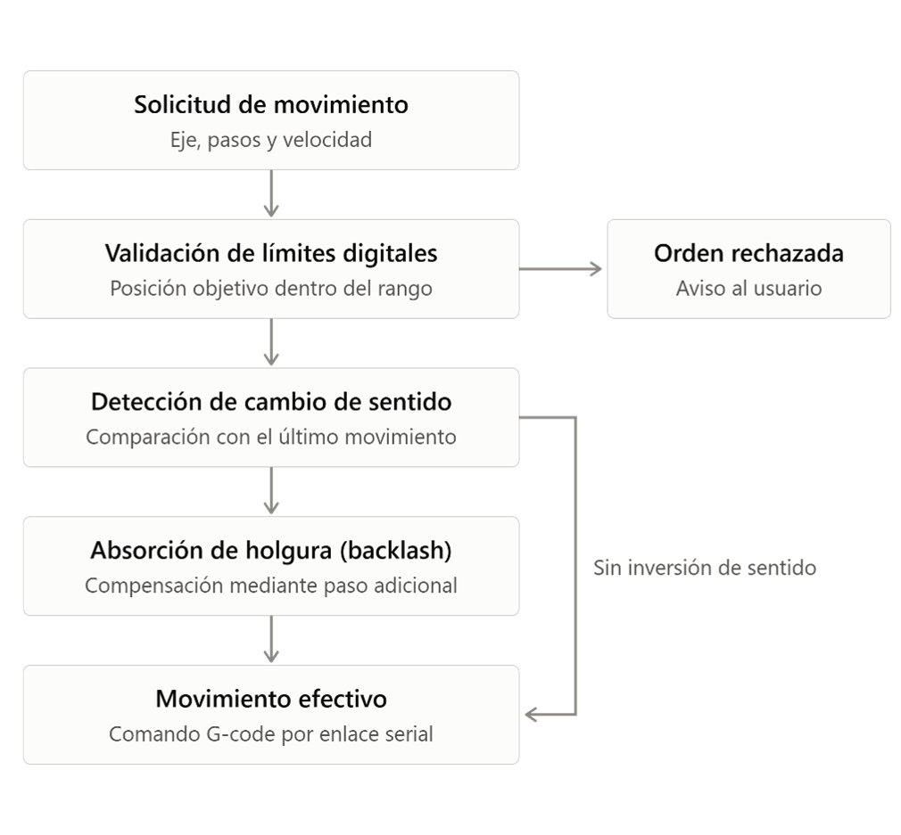
</p>
<p align="center">
  <em>Figura 9: (b) Árbol de decisión cinemático que aplica límites de recorrido suaves y absorción de backlash.</em>
</p>

- **Ejecución Asíncrona:** Los trabajos de larga duración se ejecutan en un `QThread` secundario (`CamWorker`), manteniendo el bucle de eventos Qt principal siempre responsivo.
- **Compensación de Backlash:** El controlador cinemático evalúa los cambios de dirección del movimiento e inyecta automáticamente pulsos de compensación pre-calibrados.
- **Límites de Recorrido por Software (*Soft Limits*):** Valida cada vector cartesiano entrante contra los límites físicos de la platina antes de transmitir el G-code, previniendo colisiones mecánicas.

## Estructura del Repositorio

```text
photolith/
├── requirements.txt        # Dependencias del entorno Python
├── file_structure.json     # Persistencia de calibración y parámetros de exposición
├── images/                 # Capturas de pantalla, diagramas y microfotografías
└── platform/               # Raíz del código fuente
    ├── main.py             # Punto de entrada de la aplicación
    ├── system_functions.py # Clase principal (composición de mixins)
    ├── constants.py        # Constantes globales y parámetros ajustables
    ├── projection_window.py# Ventana secundaria de proyección UV
    ├── motors/             # Subsistema serial de control de motores
    ├── mixins/             # 13 subsistemas funcionales (UI, visión, procesamiento)
    └── UI/                 # Paneles, widgets, temas y worker asíncrono
```

## Citación

Este software fue desarrollado como parte de la memoria / tesis de ingeniería en la **Universidad de los Andes (Chile)**, **Facultad de Ciencias e Ingeniería**. Si utilizas esta plataforma, el software o los protocolos de calibración en investigaciones o desarrollos técnicos, por favor cita el trabajo:

```bibtex
@thesis{sepulveda2026photolith,
  author       = {Sergio A. Sepúlveda Véliz},
  title        = {Sistema de Fotolitografía para Micro y Nanofabricación (Máscara Digital)},
  school       = {Universidad de los Andes},
  department   = {Facultad de Ciencias e Ingeniería},
  year         = {2026},
  address      = {Santiago, Chile},
  note         = {Repositorio de código abierto}
}
```

## Licencia

Este proyecto es software libre y de código abierto bajo la [Licencia MIT](LICENSE).
